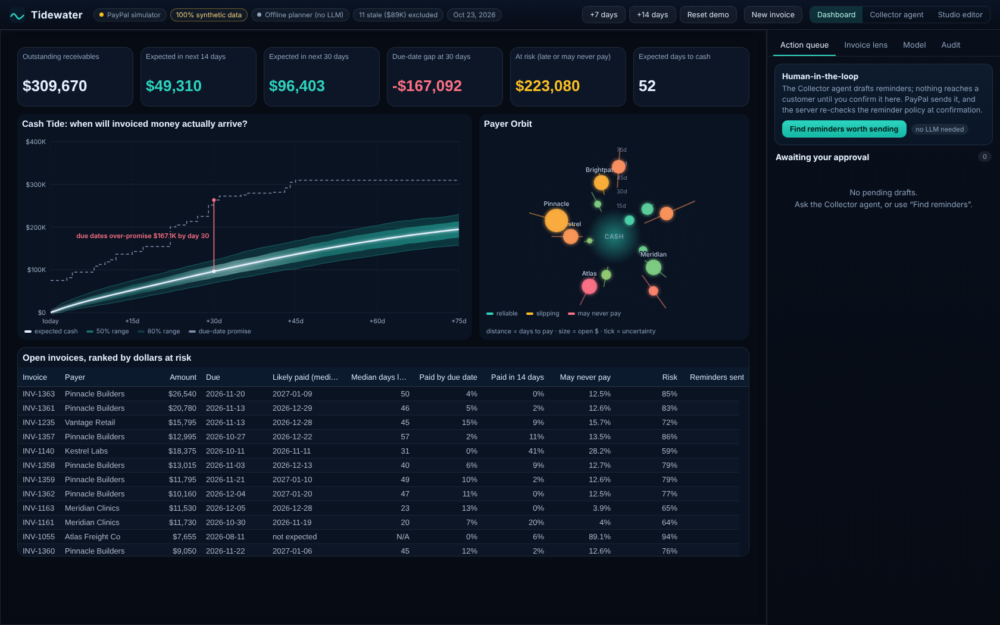
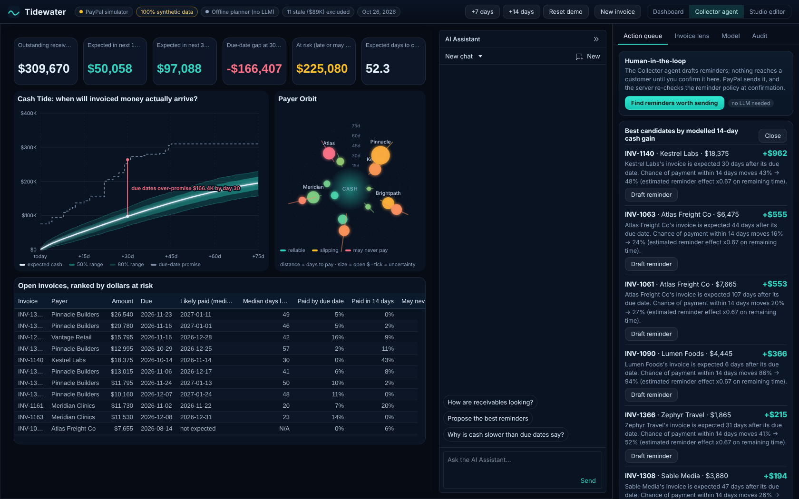

# Tidewater

**A receivables-forecasting cockpit for PayPal invoices, built on AG Grid's AG Studio.**

Tidewater predicts *when* each open PayPal invoice will be paid, as a probability distribution rather than a single date. It rolls those into a cash-inflow forecast, and lets an AI agent propose payment reminders that a human confirms before PayPal sends them.



> **Data disclosure.** The default demo runs on a **PayPal simulator with synthetic invoices** (clearly badged in the header). Synthetic payers have hidden payment behaviour so the forecast can be checked against ground truth. Nothing here is evidence about real merchants. Sandbox mode (below) talks to the PayPal **sandbox** only; the code refuses any other host.

## What it does

- **Payment-date distribution per invoice.** A hierarchical censored log-normal model with a "never pays" (ghost) component, fit by EM. Open invoices are right-censored, not treated as missing.
- **Cash Tide** (custom AG Studio widget). A probability ribbon of expected inflow over time, compared with a naive due-date curve.
- **Payer Orbit** (custom AG Studio widget). A radial view of payers by open dollars and risk.
- **Collector agent** (AG Studio AI panel). Ranks invoices by expected 14-day cash gain from a reminder, simulates the effect on the tide, and drafts a reminder. It can only *propose*.
- **Human-only confirm.** Sending goes through a confirm endpoint the agent cannot call. Policy is enforced on the server at propose time and again at confirm time: invoice must be sent/unpaid, max 3 reminders, at least 5 days apart, only within 3 days of due or overdue, one pending proposal per invoice.
- **Audit log** of every proposal, confirmation, block and send.
- **Model panel** showing estimated reminder effect with an 80% interval, and a backtest summary.
- AG Studio view mode (dashboard), edit mode (drag, rearrange, build your own widgets), and the AI panel.



## Live demo

**Demo video:** https://youtu.be/cNRbFVvUTe4

https://tidewater-mink.onrender.com runs in **simulator mode** (synthetic data, no PayPal credentials, no LLM key). Notes:

- It is on Render's free plan, so the first request after a quiet period can take about a minute while the service wakes up.
- The simulated clock and ledger are **shared by everyone using the demo**. If it looks odd after someone else clicked **+14 days**, press **Reset demo** (header; click twice to confirm) to restore the starting state.
- The PayPal sandbox integration is not exposed on the public URL; run it locally with your own sandbox keys (below).
- On a phone the dashboard scrolls sideways inside its own area; the layout is designed for a desktop screen.

## Run it

Requires Node >= 22.13.

```bash
npm ci
npm run dev          # API on :8787, web on :5173
```

Or as a single process:

```bash
npm run build
npm start            # http://localhost:8787
```

With no environment variables it runs offline: PayPal simulator, synthetic data, and the deterministic offline planner for the agent (this is **not** a language model; the header badge says so).

Use **+7 days / +14 days** in the header to advance the simulated clock and watch invoices settle against their hidden truth.

### Optional: PayPal sandbox

Copy `.env.example` to `.env`, fill `PAYPAL_CLIENT_ID` and `PAYPAL_CLIENT_SECRET` from a sandbox REST app. Then:

```bash
npm run paypal:smoke   # create -> send -> remind -> record payment -> read, against your sandbox
```

### Optional: a real LLM

Set `LLM_BASE_URL`, `LLM_API_KEY`, `LLM_MODEL` to any OpenAI-compatible `/chat/completions` endpoint. The key stays on the server (`/api/llm/chat` proxies).

### Deploying (Render)

`render.yaml` is a Render Blueprint (free plan, Node 22, health check at `/api/health`). Leave the secret variables empty for a public simulator-only demo. If you do set `LLM_API_KEY` on a public deployment, also set a spend limit in your provider's dashboard: the server has an in-memory per-IP limit (`LLM_PER_MIN`, default 12) and a total daily cap (`LLM_DAILY_CAP`, default 300 calls per UTC day), but both reset on restart and are not a substitute. Write requests are limited per IP (`RATE_LIMIT_PER_MIN`, default 120). `TRUST_PROXY` (default 1) is the number of reverse-proxy hops trusted for the client IP.

## Tests and backtest

```bash
npm run typecheck
npm test             # 58 tests
npm run backtest     # regenerates docs/BACKTEST.md
```

See [docs/BACKTEST.md](docs/BACKTEST.md) and [docs/METHOD.md](docs/METHOD.md).

## Architecture

```
web/ (React 18 + AG Studio 3)  <->  server/ (Express + node:sqlite)
  studio/  widgets, state, theme       forecast/  model, math, portfolio, backtest
  ai/      Collector tools + adapters  services/  ledger, actions, proposals, seed
  panels/  queue, lens, model, audit   paypal/    port, sim (simulator), live (sandbox REST)
```

`PayPalPort` has two implementations: `SimPayPal` (hidden ground truth, virtual clock) and `LivePayPal` (sandbox REST, OAuth, retries, webhook verification).

## Honest limitations

- **`LivePayPal` has been run against the real PayPal sandbox once** (17 Oct 2026, `npm run paypal:smoke`): create and send an invoice with a specific due date, read it back, send a reminder, record a payment, read it back as `MARKED_AS_PAID`, and list invoices all succeeded. That confirms the endpoint paths, request bodies and `DUE_ON_DATE_SPECIFIED`. **Not yet verified against the real sandbox:** webhook signature verification and event delivery, a payer paying a hosted invoice through PayPal's own checkout (the smoke test records the payment through the API instead), The full app was also run in sandbox mode on 19 Oct 2026: a drafted reminder was confirmed by a human and the audit trail recorded "Reminder sent via PayPal" for a real sandbox invoice. The webhook handler reacts to any `INVOICING.*` event and re-syncs, and the app also polls, because sandbox webhooks are reported to be unreliable.
- **The LLM path has been tested only against a mock OpenAI-compatible server.** Compatibility with specific providers is unverified.
- **All backtests and reminder-effect results are on synthetic data.** The reminder effect is estimated observationally and assumes reminded and un-reminded invoices are comparable. The weaker effect of repeat reminders (exponent 0.5) is an assumption.
- Median-date error in the well-specified backtest is about 18.9 days, against 18.0 for an oracle that knows every payer's true parameters, so almost all of it is irreducible noise in that synthetic data. Real payers may be harder or easier. The value is calibrated uncertainty (80% interval observed 77-82%), not precise dates.
- Reminder effect: the interval is now a payer-level cluster bootstrap. On synthetic ledgers the 80% interval contained the true value in 35/40 runs on one seed set and 30/40 on another (expect roughly 75-90%). The estimate still leans slightly toward "no effect" (mean log-bias about +0.06).
- Invoices unpaid after 120 days are held out of forecasts and reported separately as stale.
- AG Studio is a commercial product. AG Grid's pricing page lists a 45-day free trial and says licence pricing depends on how it is deployed; it does not say what happens when the trial ends, or whether a hosted demo is covered. Ask AG Grid (sales form on their site) for a key that covers judging (Dec 1-15), and include a note in your Devpost submission.
- The public demo's simulator is shared state (see Live demo), and its rate limits are in memory and per-IP. If the host's proxy chain is not what `TRUST_PROXY` assumes, clients can share a limit bucket; that has not been checked on Render.
- The production bundle is large (~5.6 MB JS).

## Licence

MIT, see [LICENSE](LICENSE). AG Studio / AG Grid are third-party software under their own licence.
